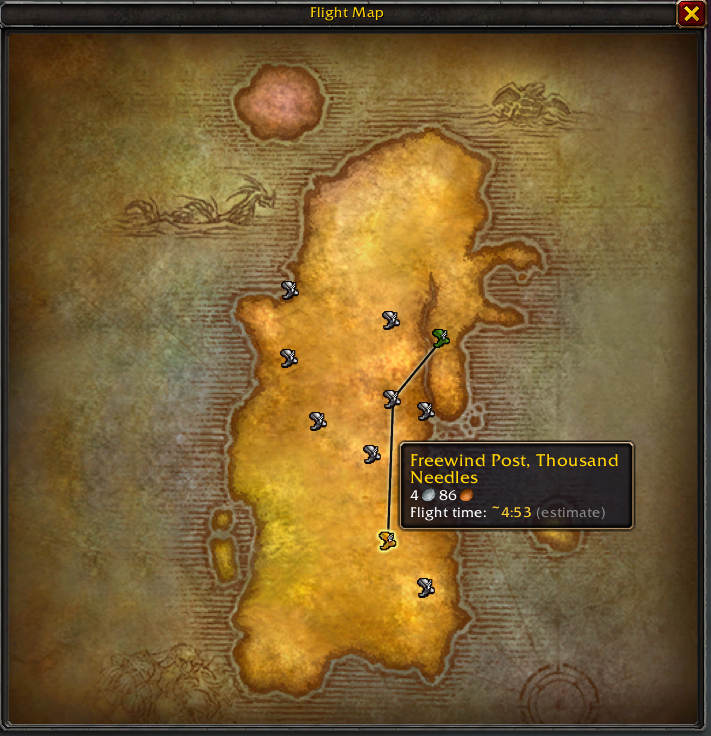
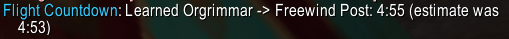
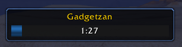

# Flight Countdown

A World of Warcraft: Forever addon that shows a countdown of your remaining
flight time while you're on a flight path.

- **Blue bar**: an exact time, learned from flying the route before (shared across your characters).
- **Amber bar with `~`**: an estimate. Each hop's real flown length comes from the game's
  flight path data, divided by a flight speed the addon learns as you fly.
- Accounts for the Frequent Flier perk (20% faster flights).
- Hovering a destination on the flight map shows its flight time in the tooltip.
- Survives `/reload` mid-flight. Landing early doesn't save a wrong time.

## Screenshots

**Flight time on the flight map.** Hover a destination to see how long the trip takes.



**Estimate in flight.** A route you haven't flown yet shows an amber bar with `~`.


**Learning the real time.** When you land, the measured time is saved and compared with the estimate.



**Exact time in flight.** Once a route has been flown, it shows a blue bar with the exact time.



## Install

With [CurseBreaker](https://github.com/AcidWeb/CurseBreaker):

```
install gh:burk3/FlightCountdown
```

Or download the zip from [Releases](https://github.com/burk3/FlightCountdown/releases) and extract it into
`World of Warcraft\_forever_\Interface\AddOns`.

## Commands

| Command | |
|---|---|
| `/fc unlock` / `/fc lock` | Move the bar |
| `/fc reset` | Reset bar position |
| `/fc test` | Show a 20-second demo |
| `/fc tooltip` | Toggle the flight map tooltip line |
| `/fc forget` | Erase learned flight times |

## Route data

`RouteData.lua` is generated from the game's `TaxiPath` and `TaxiPathNode`
tables (via [wago.tools](https://wago.tools)). Regenerate it when Forever
changes its flight paths:

```powershell
./tools/Generate-RouteData.ps1 -Build 1.60.1.70938
```

The build number is in `World of Warcraft\.build.info` (the `wowf` line).

Players don't lose their recorded times when the data is regenerated. Each
recorded time stores the route length it was flown at, and is only ignored
(and re-learned on the next flight) if that route's length changed by more than
2%. Changes to the addon's own saved-data format are handled by a schema
version and one-time migrations in `FlightCountdown.lua`.

## Releasing

Push a tag like `v1.0.1`. The GitHub Action packages the addon with the
[BigWigs packager](https://github.com/BigWigsMods/packager) and publishes a
GitHub release (zip + `release.json`) and uploads the same zip to
CurseForge (project 1801982, `CF_API_TOKEN` secret) and Wago (project
qGZAkvKd, `WAGO_API_TOKEN` secret). Pushes to
`main` build a zip as a workflow artifact without releasing.
